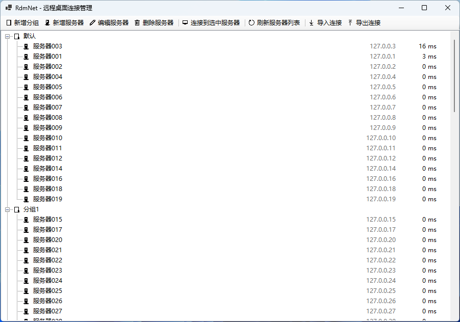

# RdmNet

基于 .NET 10 的 WinForms 桌面程序，用于管理 Windows 远程桌面（RDP）连接，不依赖 WebView 组件。

程序编译为单个可执行文件，并提供自带 .NET 运行时（无需任何依赖）与不带运行时（体积更小）两种发布版本。

> 说明：下文中的“服务器”指一条已保存的 RDP 连接配置（对应 connections.json 中的一条记录）。

## 系统要求

- 操作系统：Windows 10 / 11（64 位），需包含 mstsc 远程桌面客户端
- .NET 运行时：使用自带运行时版本时无需安装；使用不带运行时的轻量版本时需预装 .NET 10 Desktop Runtime (x64)
- 账户：需以保存连接数据的同一 Windows 用户运行，密码密文与“当前机器 + 当前用户”绑定

## 构建

构建需要 .NET SDK 10.0 或更高版本。两种发布方式均编译为单个 exe：

```powershell
# 自带 .NET 运行时（约 47 MB），目标机无需任何依赖，拷贝即运行
dotnet publish src/RdmNet/RdmNet.csproj -c Release -r win-x64 -o publish/self-contained

# 不带运行时（约 0.2 MB），目标机需预装 .NET 10 Desktop Runtime (x64)
dotnet publish src/RdmNet/RdmNet.csproj -c Release -r win-x64 -o publish/framework-dependent --self-contained false -p:EnableCompressionInSingleFile=false
```

编译产物分别为 publish/self-contained/RdmNet.exe 与 publish/framework-dependent/RdmNet.exe。

应用程序图标为 src/RdmNet/app.ico，通过 csproj 的 `<ApplicationIcon>` 在编译时作为 Win32 资源嵌入 exe（显示在资源管理器、任务栏和窗口标题栏），无需随 exe 单独分发，两种发布版本均包含该图标。

界面内图标（工具栏按钮、右键菜单、列表中的分组与服务器节点）不使用任何外部资源文件，而是运行时由 Windows 自带的 Segoe MDL2 Assets 字体字形渲染生成，按当前 DPI 缩放；若系统缺少该字体会自动回退为纯文字显示。

## 数据存储

连接数据保存在 exe 目录下的 connections.json 中，密码使用 Windows DPAPI（CryptProtectData）加密存储。

加密密钥由 Windows 按当前用户自动生成和管理，不落盘、不随程序分发，因此密文仅能被同一台机器上的同一 Windows 用户解密。

exe 目录下还会生成 pending_credentials.json：它记录本程序写入过的 TERMSRV 系统凭据，仅用于程序异常退出后清理遗留凭据，不参与导入导出。

已知限制：连接时密码明文会作为参数传给 cmdkey，因此会短暂出现在 cmdkey 进程的命令行中。

## 远程连接（mstsc 集成）

连接远程服务器时，程序通过 mstsc 打开远程桌面连接窗口，完整流程如下：

1. 解密 connections.json 中该服务器的密码（DPAPI CryptUnprotectData）。
2. 写入系统凭据，使 mstsc 免密登录（凭据目标名的规则见下方说明）：
   ```
   cmdkey /generic:<凭据目标> /user:<用户名> /pass:<明文密码>
   ```
3. 启动远程桌面连接：
   ```
   mstsc /v:<服务器地址>:<端口>
   ```
4. 远程桌面窗口关闭后，删除已写入的凭据：
   ```
   cmdkey /delete:<凭据目标>
   ```

说明：
- 凭据目标名：端口为默认端口 3389 时使用 `TERMSRV/<服务器地址>`，端口非默认时使用 `TERMSRV/<服务器地址>:<端口>`；删除时必须使用与写入完全一致的目标名。
- 凭据仅在连接存续期间存在；程序异常退出时，会在下次启动时清理遗留的 TERMSRV 凭据（仅清理本程序写入过的目标）。
- 同一台服务器同时打开多个远程桌面窗口时，凭据在最后一个窗口关闭后才删除。
- 若保存的密码为空，则跳过第 2 步，由 mstsc 弹出系统登录框手动输入；若写入凭据失败，同样退回手动输入。

## 界面功能

### 工具栏

主窗口上方工具栏包含以下功能（每个按钮以“图标 + 文字”显示）：

- 新增分组
- 新增服务器
- 编辑服务器
- 删除服务器
- 连接到选中服务器
- 刷新服务器列表：重新从 connections.json 读取数据并刷新列表显示，同时检测各服务器延迟
- 导入连接
- 导出连接

### 连接列表

主窗口中心区域显示所有分组和服务器，每个分组下显示该分组下的服务器，分组节点显示文件夹图标、服务器节点显示服务器图标；服务器和分组可拖动排序，服务器可拖拽到其他分组下（拖到分组节点上会移入该分组的末尾）；分组之间只能并列排序，不能拖入分组内部。

- 双击服务器：连接到该服务器
- 右键服务器：弹出上下文菜单，包含连接、编辑服务器、删除服务器
- 右键分组：弹出上下文菜单，包含新增服务器、重命名分组、删除分组
- 双击分组名称：就地重命名分组（右键菜单“重命名分组”同效）

### 服务器延迟

- 每个服务器条目右侧显示到该服务器的延迟，单位为毫秒（ms）
- 延迟左侧以灰色字体显示服务器地址：默认端口 3389 只显示地址，非默认端口显示“地址:端口”；地址过长时以省略号截断，分组行不显示地址
- 延迟通过 TCP 连接该服务器的 RDP 端口测量（从发起连接到建立 TCP 连接的耗时），比 ICMP ping 更能反映 RDP 实际可用性
- 超时时间为 3 秒，超时或连接失败时显示“离线”，悬停条目可查看失败原因
- 检测过程中条目右侧显示“…”，界面保持可用
- 点击“刷新服务器列表”时，先取消上一轮尚未完成的检测，再重新从 connections.json 读取数据并刷新列表显示，然后对所有服务器并发检测；刷新后保持当前选中的服务器不变
- 检测结果在界面线程按固定间隔批量刷新，避免逐个节点重绘
- 新增、编辑服务器以及导入连接后会自动触发一次检测

### 分组规则

- 仅支持单层分组，不支持嵌套
- 未指定分组的服务器归入默认分组“默认”
- 删除分组时，组内服务器移入默认分组，不随之删除
- 默认分组不能删除

### 新增 / 编辑服务器

在新增或编辑服务器窗口中填写以下内容，点击“确定”即可保存：

- 分组名称（输入或选择）
- 服务器名称（可留空，留空时自动填充为服务器地址）
- 服务器 IP 地址或域名，以及端口号（默认 3389，必填）
- 用户名
- 密码

## 界面截图



> 截图待补充：请将主窗口截图保存至 docs/screenshot.png。

## 导入 / 导出

- 导出：选择导出路径，将连接列表导出为 JSON 文件
  - 由于 DPAPI 密文仅能被本机当前用户解密，导出时默认不写入密码字段
  - 可选：导出时输入一个导出密码，使用该密码对所有服务器密码进行对称加密（AES-GCM）后写入导出文件
  - 导出文件结构：`version`、`encrypted`、`kdf`（PBKDF2-SHA256 的迭代次数与 salt）与 `groups`
  - 启用加密时，每台服务器额外包含 `passwordEncrypted`（`nonce`、`ciphertext`、`tag`，均为 base64）
- 导入：选择 JSON 文件，校验文件格式
  - 若文件包含加密的密码字段（`encrypted` 为 true），需输入导出时使用的密码进行解密
  - 解密后的密码在导入时使用 DPAPI 重新加密后存入 connections.json
  - 若文件来自同一台机器的同一用户且保留了 `password` 字段，则直接复用其中的 DPAPI 密文
  - 导入的分组与服务器合并到现有列表：分组按名称合并，重名判定键为“同一分组内服务器名称相同”（不区分大小写），按用户选择覆盖或跳过，取消则中止整次导入且不保存任何更改

## 许可证

本项目采用 [MIT](https://opensource.org/licenses/MIT) 许可证，详见 [LICENSE](LICENSE)。
